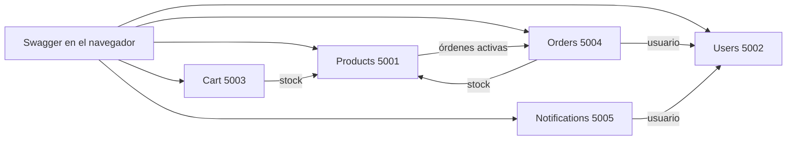
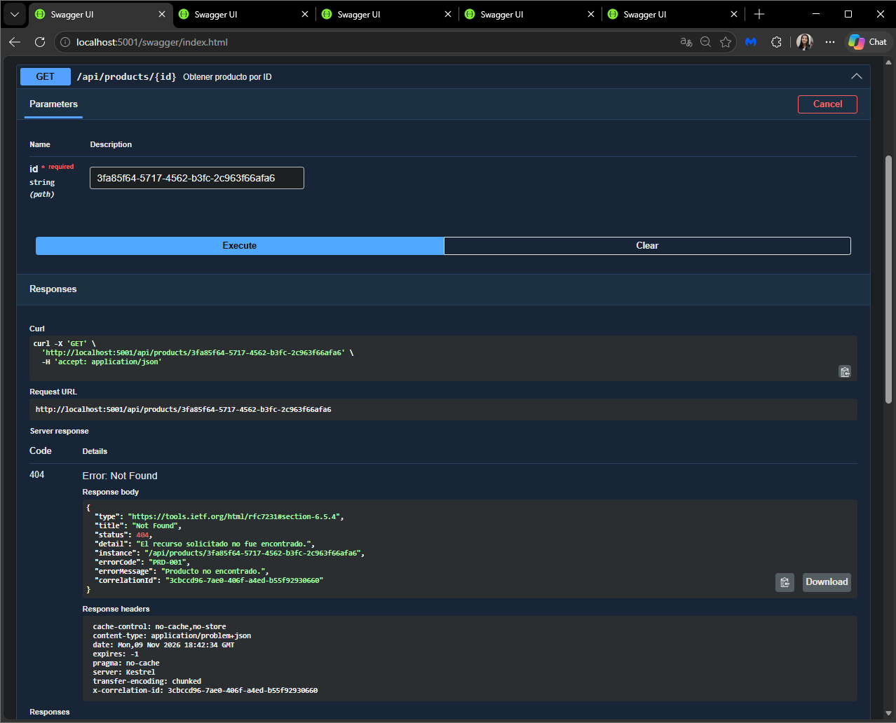
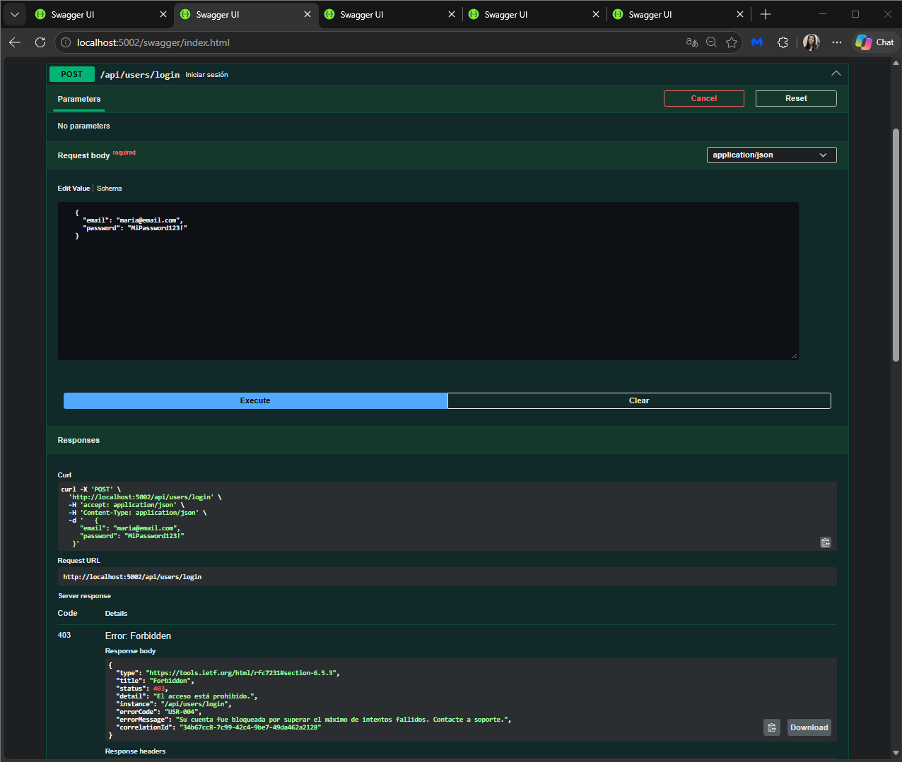
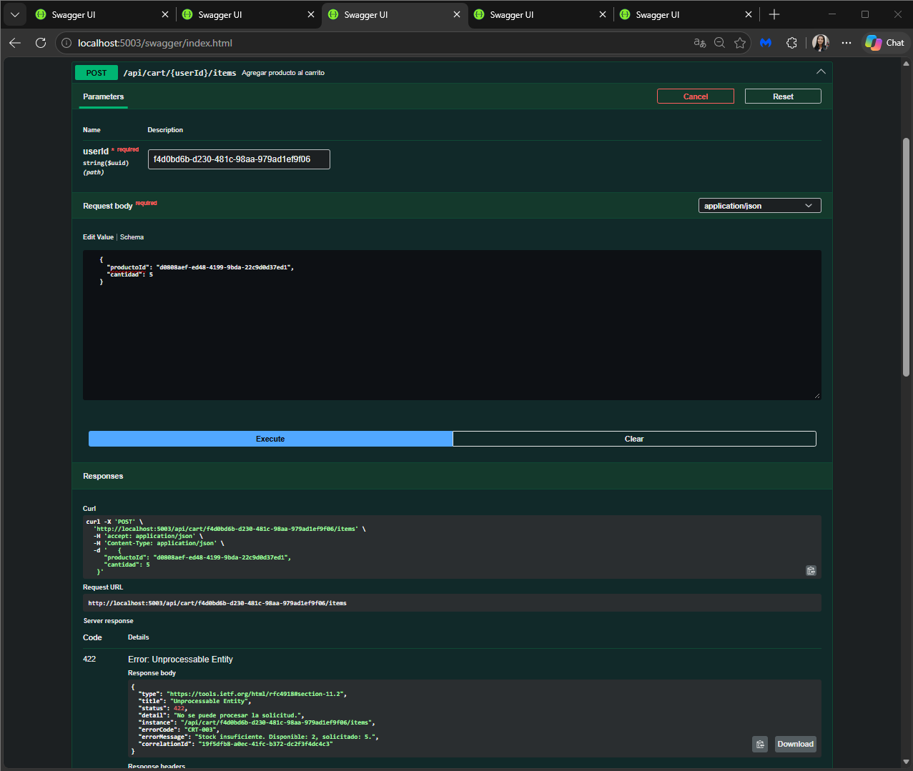
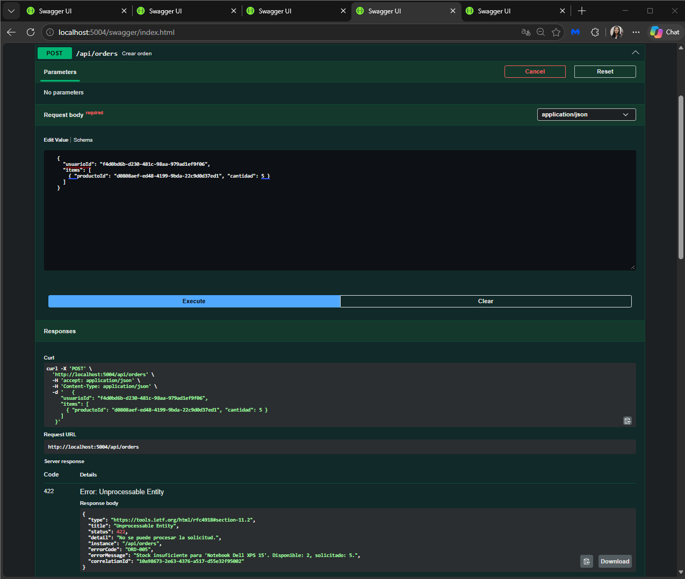
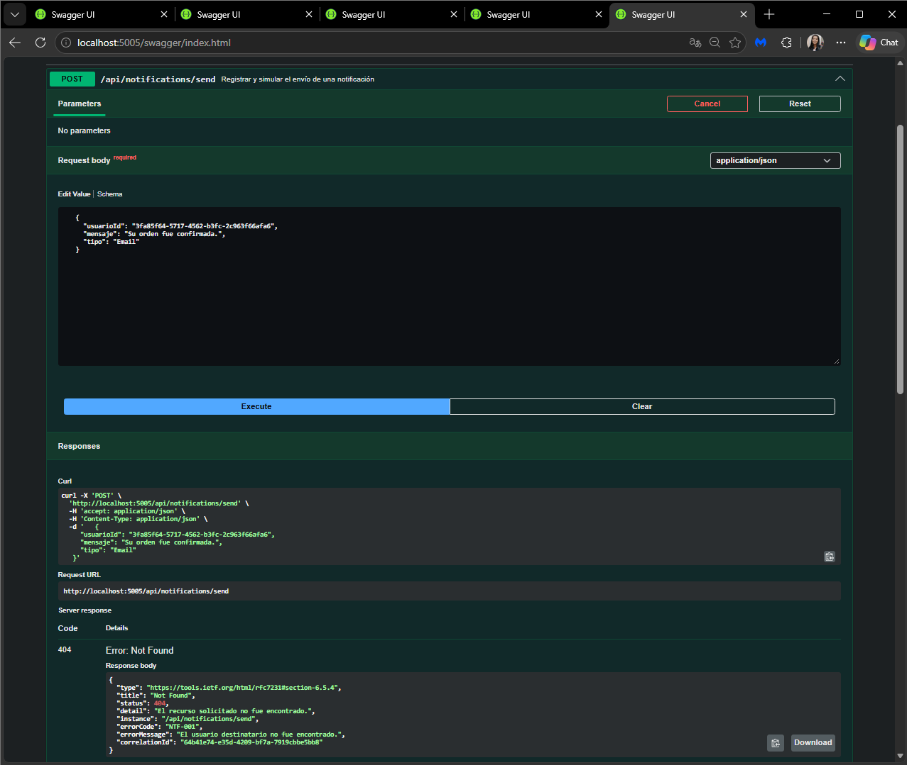

# E-Commerce con microservicios (.NET 10) - Grupo 18

Cinco REST APIs independientes. Cada una tiene su propia base SQLite.

## Cómo ejecutar

Requisito: SDK de .NET 10.

1. Clonar el repositorio.
2. Abrir `ECommerce.sln` y compilar con **Compilar → Recompilar solución**. La primera compilación descarga los paquetes y tarda más.
3. Cerrar Visual Studio y hacer doble clic en `iniciar-todo.bat`.
4. Se abren 5 ventanas, una por servicio, y la página de Swagger de cada uno. Si alguna pestaña no carga, esperar unos segundos y recargarla.

También se puede abrir `ECommerce.sln`, elegir "Configurar proyectos de inicio",
marcar "Varios proyectos de inicio" y poner los 5 en "Iniciar".

## Servicios y puertos

| Servicio          | Puerto | Swagger                       | Descripción                  |
|-------------------|--------|-------------------------------|------------------------------|
| Products.API      | 5001   | http://localhost:5001/swagger | Catálogo y stock             |
| Users.API         | 5002   | http://localhost:5002/swagger | Registro, login y bloqueo    |
| Cart.API          | 5003   | http://localhost:5003/swagger | Carrito por usuario          |
| Orders.API        | 5004   | http://localhost:5004/swagger | Órdenes y estados            |
| Notifications.API | 5005   | http://localhost:5005/swagger | Notificaciones simuladas     |

Cada servicio expone `/health`, `/health/ready` y `/health/live`.

## Arquitectura

| Programa | Puerto | Se encarga de | Le pregunta a |
|---|---|---|---|
| Products.API | 5001 | Catálogo de productos y stock | Orders, antes de borrar un producto |
| Users.API | 5002 | Registro, login y bloqueo tras 3 fallos | Nadie |
| Cart.API | 5003 | Carrito de cada usuario | Products, por existencia y stock |
| Orders.API | 5004 | Órdenes de compra y sus estados | Users y Products |
| Notifications.API | 5005 | Registro de avisos simulados | Users |

La comunicación entre servicios es por HTTP con IHttpClientFactory.
El header X-Correlation-Id viaja en cada llamada entre servicios.

## Códigos de error

| Código  | HTTP | Mensaje                                                 |
|---------|------|---------------------------------------------------------|
| PRD-001 | 404  | Producto no encontrado.                                 |
| PRD-002 | 400  | Los datos del producto son inválidos.                   |
| PRD-003 | 409  | Ya existe un producto con ese nombre en la categoría.   |
| PRD-004 | 409  | El producto tiene órdenes activas y no puede eliminarse.|
| PRD-005 | 500  | Error interno al procesar el producto.                  |
| USR-001 | 409  | El email ya está registrado.                            |
| USR-002 | 400  | Los datos del usuario son inválidos.                    |
| USR-003 | 401  | Credenciales incorrectas.                               |
| USR-004 | 403  | Usuario bloqueado por demasiados intentos fallidos.     |
| USR-005 | 403  | Usuario bloqueado por detección de fraude.              |
| USR-006 | 500  | Error interno al procesar el usuario.                   |
| ORD-001 | 404  | Orden no encontrada.                                    |
| ORD-002 | 400  | Los datos de la orden son inválidos.                    |
| ORD-003 | 404  | Usuario no encontrado al crear la orden.                |
| ORD-004 | 404  | Producto no encontrado al crear la orden.               |
| ORD-005 | 422  | Stock insuficiente para uno o más productos.            |
| ORD-006 | 409  | El estado de la orden no puede ser modificado.          |
| ORD-007 | 500  | Error interno al procesar la orden.                     |
| CRT-001 | 404  | Carrito no encontrado.                                  |
| CRT-002 | 404  | Producto no encontrado.                                 |
| CRT-003 | 422  | Stock insuficiente para agregar al carrito.             |
| CRT-004 | 400  | Cantidad inválida.                                      |
| CRT-005 | 500  | Error interno al procesar el carrito.                   |
| NTF-001 | 404  | Usuario no encontrado.                                  |
| NTF-002 | 400  | Los datos de la notificación son inválidos.             |
| NTF-003 | 404  | No se encontraron notificaciones para el usuario.       |
| NTF-004 | 500  | Error interno al procesar la notificación.              |

## Decisiones de diseño

Puntos que la consigna deja abiertos y cómo los resolvimos.

| Decisión | Motivo | Resultado |
|---|---|---|
| Persistencia con Dapper y SQLite | La consigna menciona una librería de la cátedra que no está en el repositorio | Usamos lo que trae la base del proyecto. Cada servicio tiene su propia base `app.db` |
| Endpoints en `Extensions/`, sin carpetas `Controllers/` ni `Services/` | La base de los profesores organiza así los endpoints | Mantuvimos esa estructura en los 5 servicios |
| Agregamos `GET /api/users/{id}` | Orders y Notifications tienen que validar que el usuario exista, y la consigna no define cómo | Endpoint de uso interno entre servicios |
| Crear una orden no descuenta stock | La consigna solo pide validar que haya stock | Orders consulta el stock a Products, pero no lo modifica |
| Transiciones de estado: Pendiente → Confirmada o Cancelada; Confirmada → Enviada o Cancelada; Enviada → Entregada | La consigna da un solo ejemplo de transición inválida | Un cambio no permitido responde 409 ORD-006 |
| Agregar al carrito un producto que ya está suma las unidades | La consigna no aclara si suma o reemplaza | El stock se valida contra el total acumulado. Para fijar una cantidad exacta se usa `PUT /api/cart/{userId}/items/{productId}` |

## Capturas

Errores reales devueltos por cada servicio desde Swagger.

### Products: PRD-001 (404)

### Users: USR-004 (403)

### Cart: CRT-003 (422)

### Orders: ORD-005 (422)

### Notifications: NTF-001 (404)

## Integrantes

| Integrante | Usuario de GitHub | Tareas |
|---|---|---|
| Nicole Ortiz | 901051Ortiz | C4, C6, C11, C13, C17, C18, C21 |
| Gabriel Apaza | 845369Apaza | C1, C3, C7, C9, C14, C15, C19 |
| Paloma Steinberg | palomasteinberg | C2, C5, C8, C10, C12, C16, C20 |

## Tareas y pull requests

| Tarea | Responsable | Pull request |
|---|---|---|
| C1 Base | Gabriel | #1 y commits directos a main |
| C2 Errores | Paloma | #5 |
| C3 Swagger | Gabriel | #2 |
| C4 Logs y health checks | Nicole | #3 |
| C5 Estructura | Paloma | #6 (incluye la corrección de C2) |
| C6 Products: modelo | Nicole | #9 y commit directo a main |
| C7 Products: repositorio | Gabriel | #10 |
| C8 Products: endpoints | Paloma | #11 |
| C9 Users: modelo | Gabriel | #12 y #13 (corrección) |
| C10 Users: repositorio | Paloma | #14 |
| C11 Users: endpoints | Nicole | #15 |
| C12 Cart: modelo | Paloma | #19 |
| C13 Cart: repositorio | Nicole | #16 |
| C14 Cart: endpoints | Gabriel | #17 |
| C15 Notifications: modelo | Gabriel | #18 |
| C16 Notifications: repositorio | Paloma | #25 |
| C17 Notifications: endpoints | Nicole | #21 y commit directo a main (corrección) |
| C18 Orders: modelo | Nicole | #22 |
| C19 Orders: repositorio | Gabriel | #20 y #23 (corrección) |
| C20 Orders: endpoints | Paloma | #25 |
| C21 README y capturas | Nicole | #24 y #26 |
